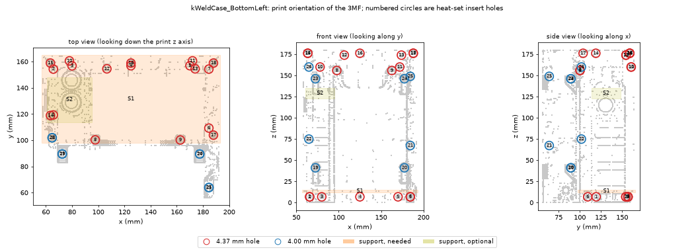
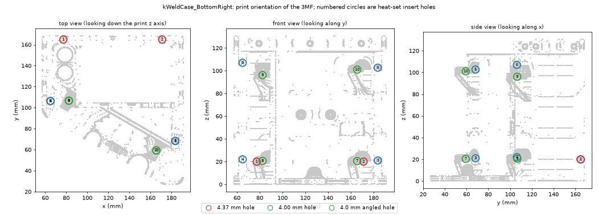
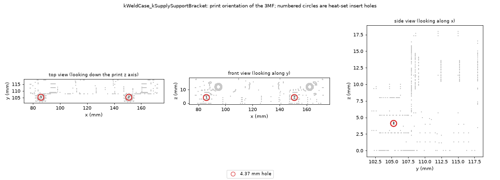
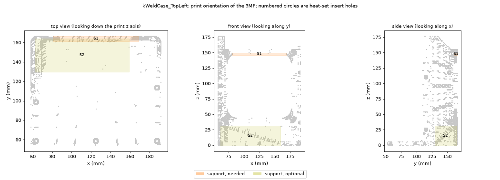
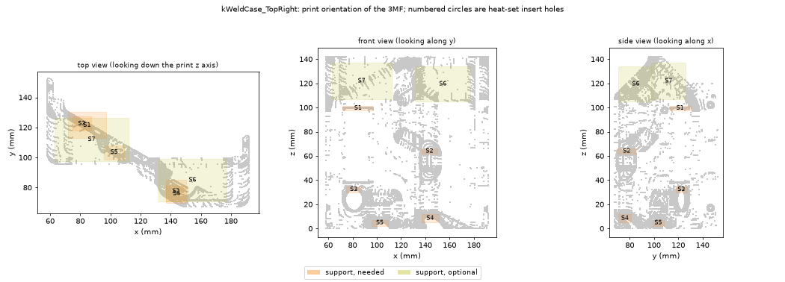

# Build

Everything here applies to [Printables 1443318](https://www.printables.com/model/1443318). The
upstream page has the author's photos, assembly notes and comments; this page records the choices
and checks specific to this build.

## Layout and heat

Judged from the author's photos and two makers' photos (one with the boards installed, one
mid-print), not from the 3MF geometry. Confirm during assembly.

- The long left section is the tall one. The kCap board lies on its top deck with the six
  capacitor cells standing up through it; the fan shroud sits directly over the cells and the fan
  on top of that. The kSupply is below the kCap board, with its heatsink, and the HP power supply
  slides in from the rear into the lower part of the left and right sections.
- The right section holds the kWeld under the angled cover: LCD, dial, and the two electrode
  cables out of the angled end. The power button and the nameplate are on the lower front.
- The side slots next to the fan shroud open onto the kCap board's terminals, so air can move
  through the kCap compartment. Which way the fan blows is not specified upstream; the author and
  two makers all used different fans. Pick a direction, measure (below), and flip it if needed.

Where the heat is, and what the fan does:

- The capacitors are the part that matters. They are rated 70 C, and the kCap lights its
  overtemperature LED at about 45 C. The kCap runs its fan from its own fan connector and starts
  it at about 45 C, so the fan exists to cool the cells directly. Keenlab's quoted repetition rate
  (50 J pulses once every 2 seconds) assumes that fan fitted. Without a fan, expect to take
  cooling breaks.
- The HP power supply has its own fans and its rear faces the open rear bay, so most of its heat
  leaves the case there. It still warms the case floor and the air below the kSupply.
- The kWeld's power switch is the least stressed: its resistance is a small fraction of the
  kCap's, so it heats much less per pulse. It locks welding out at 70 C and shows the temperature
  on its status screen.

Expect modest temperatures for light use, but this is reasoning, not measurement. Measure on the
first session: the kWeld status screen for its switch, the kCap overtemperature LED, and a probe
or infrared thermometer on the case near the capacitors and the supply.

## Parts

Printed, in `models/printables-1443318/`. Sizes are the 3MF bounding boxes, in print orientation,
in mm (x, y, z). The printer here is a Prusa MK3S+ (250 x 210 x 210), so every part fits. The
photos suggest the two "Top" parts are the covers (kCap and kWeld) and the two "Bottom" parts the
base with the power supply bay and front panel.

- kWeldCase_BottomLeft: 134 x 108 x 180
- kWeldCase_BottomRight: 134 x 141 x 131
- kWeldCase_TopLeft: 134 x 113 x 177
- kWeldCase_TopRight: 134 x 85 x 142
- kWeldCase_FanShroud: 120 x 48 x 120
- kWeldCase_kSupplySupportBracket: 94 x 16 x 18
- kWeldCase_Nameplate: 110 x 32 x 3
- kWeldCase_PowerButton_Wrench: 34 x 34 x 60

### Parts checklist

Counts are the upstream author's; the upstream page is authoritative. Tick what you have.

Hardware, all M3. The totals match: 47 screws and 47 inserts.

- [ ] Heat-set inserts, 47: Ruthex RX-M3x5.7 (4.6 mm outer diameter, 5.7 mm long). The upstream
  link, ASIN B08BCRZZS3, was this part but now opens a 1/4-20 insert listing; neither M3 option in
  its dropdown is this insert. RX-M3Sx4.0 has the same diameter but is 4.0 mm long, so it grips
  less thread. RX-M3x5x4 (VORON) is 5.0 mm across, too wide for the 4.0 mm holes.
- [ ] Flat-head, 16 x 6 mm (top and left/right joint).
- [ ] Flat-head, 5 x 8 mm (left side).
- [ ] Flat-head, 4 x 10 mm (feet).
- [ ] Flat-head, 2 x 12 mm (kSupply bracket).
- [ ] Button-head, 16 x 6 mm (boards to case).
- [ ] Socket-head, 4 x 30 mm, with 4 washers (fan and grille).

Electrical and other:

- [ ] Lit pushbutton switch, 16 mm. The case hole is 16.5 mm and the printed wrench fits a nut
  of about 19 mm across flats, so buy the 16 mm size, not 19 or 22 mm. It switches the kSupply's
  PSU enable line, which the kSupply manual describes as a jumper or a switch, so it must be
  latching. Chosen: a stainless, IP67, latching, 1NO switch with a 5 to 24 V LED, 20 A contacts
  and a plug-in wire socket, 16 mm panel cut. The LED range covers the kSupply output (8.4 V or
  more). Colour is cosmetic. The listing gives an item length of 3.9 in; that likely includes the
  plug and wires, but check the depth behind the front panel when test-fitting. For the
  HSTNS-PR01 the kSupply manual ("Usage with HSTNS-PR01") enables the supply with one jumper or
  a switch on the enable terminal.
- [ ] Pedal jack Switchcraft 142AX and plug 750, or whatever matches your pedal's plug. Not yet
  checked.
- [ ] 120 mm fan and grille. Your Corsair SP120 Elite is 12 V and 0.3 A, inside the kCap's 500 mA
  limit. It has a 4-pin PWM plug and the kCap fan header looks like a small 3-pin one in the
  maker's photo; check the pitch and whether your kCap kit included a fan cable.
- [ ] Four rubber feet (upstream: Keystone 722).
- [ ] Hookup wire, ferrules and ring terminals for the switch and jack; a crimper. The author
  shortened the 8 AWG cables and crimped new terminals.
- [ ] A knob for the kWeld dial, if the stock one does not fit the case: it did not for one
  maker. A printable "16mm wide rotary encoder knob" is Printables 1504384; fit unverified.
- [ ] Cyanoacrylate gel for the nameplate.

Things makers reported on the Printables page:

- The ring terminals joining the kSupply and kCap stick out the back with no clearance. One
  maker planned to cut the back of the case; the author's answer is not posted.
- A supply can shut down on inrush when first connected to the kCap. The kSupply manual
  ("Setting output voltage and current") says to set the current limit before connecting the
  kCap, and to lower it for a weaker supply.
- PETG shrinks; one maker adjusted for it.

### Heat-set inserts

Upstream does not say where the inserts go. These holes were found by slicing the 3MF meshes, not
from upstream, so treat them as measured but unconfirmed until test-fit. The parent model, Printables
928957, lists 25 inserts; this remix lists 47.

Hole sizes: 4.37 mm and 4.00 mm. Most are 5 to 8 mm deep; BottomLeft 19, 20, 23 and 24 and the
four angled BottomRight holes are 12.8 to 14.2 mm deep. Ruthex's table for RX-M3x5.7 lists D1 4.6,
D2 3.9, D3 4.0, L 5.7, W 1.6 without naming the columns; D3 as the hole size is inferred.
BottomLeft 22 and 26 are only 5.0 mm deep, so a 5.7 mm insert will not sit flush in them:
test-fit, or use the shorter RX-M3Sx4.0 there. BottomLeft 4 and 5 are 5.8 mm deep, which leaves
0.1 mm to spare. Press an insert in flush with the surface, no deeper, including in the deep
holes: inserts at the bottom-part joint pushed too far block the power supply from sliding in and
out.

38 of the 47 are located: BottomLeft 26, BottomRight 10, bracket 2. The upstream hardware list
implies 21 for the top and joints, 4 feet, 2 for the bracket screws, 16 boards and 4 fan. Located
and paired to a screw: 20 of the 21 top and joint inserts, and BottomLeft 12 and 13, which take
the bracket screws. The other 16 located holes, including the bracket's own 2, are board or fan
candidates, listed under "Which screw goes where". Not found: 1 top or joint, the 4 feet, and 4
board or fan inserts, 9 in all.

The fan shroud's four 4.1 mm holes run through the part. Whether the fan screws thread into inserts
there or into BottomLeft 19, 20, 23 and 24 is not determined.

Each image shows the part in its 3MF print orientation (z up, bed at z = 0), with every located
hole numbered. Positions below are mm from the part's minimum x, y and z corner. Axis is the
direction the hole points along.

#### BottomLeft, 26

| # | Dia | Axis | Depth | x, y, z |
|---|-----|------|-------|---------|
| 1 | 4.37 | x | 6.8 | 8, 63, 7 |
| 2 | 4.37 | x | 6.8 | 8, 98, 7 |
| 3 | 4.37 | y | 6.0 | 22, 101, 7 |
| 4 | 4.37 | y | 5.8 | 67, 101, 7 |
| 5 | 4.37 | y | 5.8 | 112, 101, 7 |
| 6 | 4.37 | x | 6.8 | 126, 53, 7 |
| 7 | 4.38 | x | 6.8 | 126, 98, 7 |
| 8 | 4.38 | z | 7.4 | 40, 44, 156 |
| 9 | 4.38 | z | 7.4 | 105, 44, 156 |
| 10 | 4.37 | y | 6.8 | 20, 104, 160 |
| 11 | 4.37 | y | 6.8 | 114, 104, 160 |
| 12 | 4.37 | y | 7.0 | 49, 98, 174 |
| 13 | 4.37 | y | 7.0 | 116, 98, 174 |
| 14 | 4.37 | z | 8.0 | 6, 63, 176 |
| 15 | 4.37 | z | 8.0 | 6, 103, 176 |
| 16 | 4.37 | z | 8.0 | 67, 103, 176 |
| 17 | 4.37 | z | 8.0 | 130, 48, 176 |
| 18 | 4.37 | z | 8.0 | 130, 103, 176 |
| 19 | 4.00 | y | 13.0 | 14, 33, 41 |
| 20 | 4.00 | y | 13.0 | 120, 33, 41 |
| 21 | 4.00 | x | 6.8 | 126, 8, 67 |
| 22 | 4.00 | x | 5.0 | 7, 46, 75 |
| 23 | 4.00 | y | 13.0 | 14, 33, 146 |
| 24 | 4.00 | y | 13.0 | 120, 33, 146 |
| 25 | 4.00 | x | 6.8 | 126, 8, 149 |
| 26 | 4.00 | x | 5.0 | 7, 46, 160 |

#### BottomRight, 10

| # | Dia | Axis | Depth | x, y, z |
|---|-----|------|-------|---------|
| 1 | 4.37 | y | 7.0 | 20, 138, 20 |
| 2 | 4.37 | y | 7.0 | 114, 138, 20 |
| 3 | 4.00 | x | 6.8 | 127, 41, 21 |
| 4 | 4.00 | x | 6.8 | 8, 79, 22 |
| 5 | 4.00 | x | 6.8 | 127, 41, 103 |
| 6 | 4.00 | x | 6.8 | 8, 79, 107 |
| 7 | 4.0 | angled | 14.2 | 108, 32, 20 |
| 8 | 4.0 | angled | 13.0 | 25, 80, 21 |
| 9 | 4.0 | angled | 12.8 | 25, 80, 96 |
| 10 | 4.0 | angled | 14.2 | 108, 32, 101 |

The four angled holes (7 to 10) form an 83 x 76 mm rectangle on the angled end. That matches a board
mounting pattern, probably the kWeld's. Their diameter is computed from an oblique section, so
treat 4.0 as approximate.

#### kSupply bracket, 2

| # | Dia | Axis | Depth | x, y, z |
|---|-----|------|-------|---------|
| 1 | 4.38 | z | 8.0 | 8, 3, 4 |
| 2 | 4.38 | z | 8.0 | 73, 3, 4 |

#### Which screw goes where

Each insert pairs with a clearance hole in a mating part at the mirrored position. Mirror sums were
checked against the 3MF coordinates, for example TopLeft y plus BottomLeft y is 217.4 for all five
top holes.

- BottomLeft 1, 2, 3, 4, 5, 6, 7 (7 holes) take the screws that join BottomRight. BottomRight has 7
  clearance holes of 3.2 mm on its joint face. Flat-head 6 mm.
- BottomLeft 14 to 18 (5) pair with TopLeft's 5 clearance holes in its floor.
- BottomLeft 21, 22, 25, 26 (4) pair with TopLeft's 4 side clearance holes.
- BottomRight 3 to 6 (4) pair with TopRight's 4 side clearance holes.
- BottomLeft 12 and 13 are 67.4 mm apart, the same spacing as the bracket's two 3.2 mm screw holes.
  They probably hold the bracket with the two 12 mm screws.
- BottomLeft 19, 20, 23, 24 sit on the 105 mm square of the 120 mm fan pattern, the same as
  TopLeft's four 3.5 mm holes and the shroud's four 4.1 mm holes. Their screw is unknown.
- Not paired: BottomLeft 8 to 11, BottomRight 1, 2 and 7 to 10, bracket 1 and 2. Candidates are the
  board mounts.

#### Finding the rest yourself

The 9 missing inserts include the 4 feet and some board mounts. To find hardware spots on any
part:

- In PrusaSlicer, step through the layers or use the cut tool and look for round blind holes of
  4.0 to 4.4 mm and 5 to 14 mm deep. A through hole of 3.0 to 3.5 mm is a screw clearance hole.
- Every clearance hole has an insert somewhere in the mating part, at the mirrored position. Count
  holes per part and match them to the screw list above: 21 for the top and joints, 16 for boards,
  4 for feet, 4 for the fan, 2 for the bracket screws.
- Round bosses standing off a wall are board mounts. Measure your boards' hole spacing and look for
  that rectangle.
- Slot-shaped or oblique holes are not inserts unless a screw needs to thread into them.
- For a hole to be sure about, test-press one insert into a spare printed hole of the same size
  first.

## Printing

- Material: PETG for BottomLeft, BottomRight, TopLeft and FanShroud; PLA for TopRight, the
  nameplate, the wrench and the bracket. The warm parts are the ones around the capacitors and
  the power supply (see above); the kWeld cover, TopRight, stays cool. The 70 C kWeld lockout and
  the kCap's 45 C overtemperature LED mean air near the cells can pass PLA's softening point of
  roughly 55 to 60 C.
- PLA softens and creeps rather than failing suddenly, so a warped PLA part is reprintable, not
  dangerous. Prusament PETG V0 is UL 94 V-0 certified, but only when printed on an MK3S+, MK4 or
  XL with Prusa's approved profiles, and it costs more; use it if a flame rating matters.
- Print the two bottom parts first and slide the power supply in before printing the rest.
- Upstream errata: the 0.15 mm gap between the left and right bottom parts is tight (0.25 mm
  would be better), and the kWeld's bottom-left screw hole sits under the display.

These settings assume importing the 3MF geometry only, not the project. The upstream projects
target a CORE One and their painted supports do not carry over to an MK3S+ profile, so set every
setting by hand.

- Upstream: CORE One, Prusament PLA for all parts, 0.25 mm BALANCED, 15 percent grid infill, 2
  perimeters. 883 g and 20.7 h in total.
- Here: 0.20 mm QUALITY, 15 percent gyroid. The MK3S+ presets appear to have no 0.25 mm profile for
  a 0.4 mm nozzle (unverified).
- Perimeters: 4 on the parts that hold inserts (BottomLeft, BottomRight, bracket, FanShroud).
  Ruthex lists a 1.6 mm minimum wall; four perimeters give about 1.8 mm. This is a recommendation,
  not checked against the wall around each hole.
- Build sheet: the textured sheet for everything. Prusa's PETG article highly recommends a textured
  or satin sheet and warns that PETG on smooth PEI can adhere too strongly; on smooth PEI use a
  glue stick. Upstream's smooth sheet was for PLA.
- Orientation: as in the 3MF, which the images show. After import, check the bed face against the
  images. If a part is flipped, rotate it to match, or the support regions below move.

Supports. Upstream painted supports only on BottomLeft, TopLeft and TopRight. The other parts have
no overhang over 35 degrees from horizontal that is more than about 17 mm across. Supports
everywhere fills holes and slopes that print cleanly without. Instead:

- Print Settings, Support material: tick Generate support material, then For support enforcers
  only, which turns off Auto-generated supports. Style: Snug or Organic.
- Right-click the part and add Support enforcer boxes over the regions in the images. Simple mode
  has boxes. Needed regions are flat ceilings and bridges; optional ones are slopes of 35 to 45
  degrees that print with a rough underside.
- BottomRight, FanShroud, Nameplate, wrench, bracket: none. The bracket's slots are bridges of
  2.2 mm; the nameplate's 2 mm ledges bridge.
- BottomLeft: S1 is a flat 65 x 134 mm ceiling 14 mm above the bed. Needed. S2 optional.
- TopLeft: S1 is an 86 x 2.6 mm strip across the top of the window, 104 mm up. Needed. S2 is the
  large 35 to 45 degree slope on the bed side; upstream left it unsupported.
- TopRight: S1 to S5 are five small ledges, 5 to 23 mm across. Needed. S6 and S7 are the angled
  cover's two roofs, optional.
- Clear support out of the insert holes before pressing inserts in.

BottomLeft's regions are drawn in its insert image above. The regions come from measuring each
mesh in the 3MF orientation. They are not checked in a slicer.

## Assembly and wiring

Upstream has no assembly steps, and its photos are all exterior. The order below is derived from
the insert pairings above, those photos, and Keenlab's manuals. Treat it as unconfirmed: dry-fit
each joint before pressing inserts or tightening screws.

What the photos show: the left section is tall, with the fan shroud and fan stacked on top and side
vents; the right section has the angled kWeld cover with the LCD, the dial and both electrode
cables; the lit button and nameplate are on the front; the power supply enters from the rear; four
feet screw into the base, two per half, and the left and right halves meet in a seam with flat-head
screws along it.

Order:

1. Print BottomLeft and BottomRight and check the power supply slides in.
2. Press in the inserts: BottomLeft, BottomRight and the bracket. Flush only.
3. Mount the boards with the 16 button-head screws. The angled end holds the kWeld, probably on
   BottomRight holes 7 to 10. The kCap and kSupply positions are not confirmed.
4. With the power supply in its bay, plug the kSupply onto its blade, fit the board into the
   bracket (below) and screw the bracket to BottomLeft holes 12 and 13 with the two 12 mm
   screws. This is a dry fit until the blade layout is checked (notes below).
5. Wire the boards, button and jack before closing. Route the cables, then join BottomLeft to
   BottomRight with 7 flat-head screws through BottomRight into BottomLeft 1 to 7.
6. If the power supply was pulled out for wiring, slide it fully in from the rear so its blade
   seats in the kSupply socket.
7. Fit TopLeft: 5 floor screws into BottomLeft 14 to 18 and 4 side screws into 21, 22, 25, 26.
   Fit TopRight: 4 side screws into BottomRight 3 to 6.
8. Fan: set the shroud on TopLeft, then fit the fan and grille with the four 30 mm screws and
   washers. Where those screws thread in is not determined; see the shroud note above.
9. Feet: four 10 mm screws and bumpers. The feet's insert holes were not found.
10. Nameplate: cyanoacrylate gel, kept off the edges because the fumes discolour nearby plastic.

### The kSupply bracket

Geometry, measured on the mesh: a bar of 94 x 16 x 18 mm. One long face has two parallel slots, each
about 83.5 mm long, 4 mm deep and 2.25 mm across, with centres 4.8 mm apart and a rib of 2.5 mm
between them. Two 3.2 mm screw holes run through the thick back, 67.4 mm apart, perpendicular to
the board. Two inserts sit in lugs 65 mm apart; their holes open on the slot face and point along
the slot depth, in the board's plane, so they cannot take screws through the kSupply's mounting
holes.

The slots are a card-edge guide: a 1.6 mm board edge slides in. The kSupply plugs onto the power
supply's blade and is "meant to be mounted directly on a specific 12V server power supply" (kSupply
manual, "Operation guide"), so the blade sets the board's height and angle and the bracket only
steadies it. The right slot is the one level with the blade. Why there are two is not known.

To choose: with the power supply in its bay and the kSupply plugged on, hold the bracket against
BottomLeft 12 and 13 and see which slot takes the board edge without bending it. This needs no
inserts. Keenlab lists the board as 86 x 53 x 18 mm without heat sinks. With a server supply the
manual prefers the heat-sink fins horizontal. For the HSTNS-PR01 it gives 50 A continuous without
heat sinks and 70 A with.

### Notes that are easy to lose

- Check the HP power supply's connector blades against the pictures in the kSupply manual,
  "Usage with HSTNS-PR01", before connecting it. The manual warns that model names do not always
  match the layout and that a different layout can damage the supply and the kSupply.
- Power button: wired to the kSupply terminal block as the kSupply manual describes. Its LED
  connects to the kSupply output.
- Foot pedal jack: the Switchcraft 142AX has a switch that shorts its wires when the plug is
  out. Wired that way, a unit powered up without the pedal starts in automatic mode. See
  [operation.md](operation.md) before relying on this.
- Input polarity on the kWeld: see the kWeld operating manual, "Using the welder". Reversed
  polarity destroys the board.
- Keenlab's assembly manual, "System", gives the bus-bar, wiring and polarity notes, including
  washer orientation.
